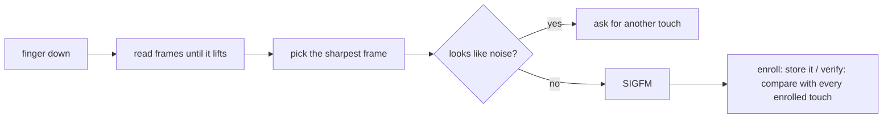

# How it works

Everything here only applies to `04f3:0c28`, the patch marks that ID in the driver and every new code path checks for it.

## Why the stock driver can't match

The `elan` driver was written for the swipe strips in laptop touchpads. It reads frames while your finger moves and stitches them into one image based on how far it thinks the finger moved. This reader is a small square pad you press, so the finger doesn't move and the stitching produces garbage.

Fixing the capture isn't enough either. libfprint matches with NBIS, which compares minutiae (the points where ridges end or split), and a pad this small barely sees any of them, so the score never gets close to a match.

## What the patch does

### Capture

The driver keeps reading until you lift your finger, because the sensor calibrates against an empty pad before every touch and fails if your finger is still there. It skips the frames from when the finger was landing and lifting, and keeps the sharpest one. Captures that look like sensor noise instead of ridges get thrown away, so noise can never be enrolled as your finger.

### Matching

SIGFM compares the ridge texture instead of minutiae, which works on tiny images. It finds points of interest in the image, describes the texture around each one, and counts how many line up between two images. Verify compares your touch with every enrolled touch and keeps the best score. The threshold comes from the [GF511 benchmarks](https://github.com/buxel/libfprint-27c6-5110/blob/main/BENCHMARKS.md), where SIGFM was tuned for an even smaller sensor.

Since each touch only sees part of your finger, enroll asks for more touches than usual.

### Storage

Prints are stored as libfprint `RAW` prints with one SIGFM entry per enrolled touch, and fprintd handles them like any other print. Prints from the stock driver don't have SIGFM data, that's why you need to enroll again.

## Changes to libfprint itself

Most of the patch is in the `elan` driver. libfprint's shared image code always used NBIS, so the patch adds a small hook, `fpi_image_device_set_matcher()`, that lets a driver swap in its own matcher. Only `elan` uses it, and only for `0c28`, every other driver works exactly as before and libfprint's tests pass.
