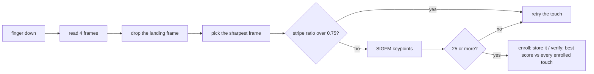

# How it works

Everything here only applies to `04f3:0c28`. The patch marks that ID with an `ELAN_PRESS` flag in the driver's ID table, and every new code path checks for it.

## The sensor

The ELAN chip reports itself as a 96x96 pixel sensor. At ~500 dpi that's about 5x5 mm of fingertip, and you press and hold it instead of swiping.

## Why the stock driver can't match

The `elan` driver was written for the 144x64 swipe strips in laptop touchpads. It reads frames while your finger moves, crops each one to 50 rows, estimates how far the finger moved between frames and stitches them into one tall image. On a press sensor the finger doesn't move, so the motion estimate can't tell up from down and the stitched image is garbage. The driver's own source has a comment saying 96x96 sensors were never tested.

Fixing the capture isn't enough. libfprint matches with NBIS, which compares minutiae (the points where ridges end or split), and its bozorth3 scorer needs 24 to call it a match:

| Image | Minutiae per scan | Best score between two scans of the same finger |
|---|---|---|
| 96x96 native | ~2 | 0 |
| 2x upscaled | ~5 | 4 |

No amount of capture tuning gets that to 24.

## What the patch does

### Capture

After 4 frames (about 0.4 s) the driver drops the first one (finger still landing), keeps the sharpest of the rest and reports the touch, so `enroll-stage-passed` shows up while your finger is still down. The sharpness is the sum of absolute differences between neighbouring pixels. Averaging frames blurs the ridges whenever the finger shifts slightly, so a single frame works better.

The driver then keeps polling until the sensor says the finger is gone, which is a 200 ms timeout or a `0xaf` reply to the pre-scan command. The sensor calibrates against an empty pad before every touch, and a finger on it during calibration makes it fail with `Calibration failed!` (the background mean is off by thousands, the limit is 500). For this sensor the driver retries the calibration every 300 ms, up to 20 times, before it gives up. A finger that lands right as calibration finishes ends up in the background, so the first frame comes out darker than the background, and the driver answers with `enroll-remove-and-retry`.

The sensor also answers `0xaf` while it settles after a touch, with nothing on it. Before any frame was read, the driver just polls again 100 ms later, and it waits for the first touch with no timeout.

Some captures come out as vertical stripe noise instead of ridges. The driver divides the standard deviation of the column means by the standard deviation of the whole image. Real ridges stay at or below ~0.65 and stripe noise is around 0.8, so anything over `ELAN_PRESS_MAX_STRIPE_RATIO` (0.75) is rejected with a retry. Without this check a noise frame could be enrolled as your finger and match another noise frame later.

### Matching

SIGFM finds keypoints with FAST-9, describes the texture around each one with a BRIEF-256 descriptor, and scores a pair of images by how many keypoints agree on a single rotation and shift (RANSAC). Ridge texture is everywhere, so a 96x96 image gives ~128 keypoints where NBIS finds ~2 minutiae.

| Setting | Value | Meaning |
|---|---|---|
| `ELAN_SIGFM_MIN_KEYPOINTS` | 25 | fewer keypoints and the touch is retried |
| `ELAN_SIGFM_THRESHOLD` | 7 | best score at or above this is a match |
| `ELAN_PRESS_ENROLL_STAGES` | 15 | touches per enroll, stock is 5 |

Verify compares your touch with every enrolled touch and keeps the best score. Both SIGFM numbers come from the [GF511 benchmarks](https://github.com/buxel/libfprint-27c6-5110/blob/main/BENCHMARKS.md), a 64x80 sensor where no wrong finger scored above 6. On this sensor wrong fingers stayed at 3 or below and matching touches scored between 7 and 20.

### Storage

Prints are libfprint `FPI_PRINT_RAW` prints whose data is a GVariant `aay`, one serialized SIGFM blob per enrolled touch. fprintd saves and loads them like any other print. Prints from the stock driver are `FPI_PRINT_NBIS` with no SIGFM data, so verify logs `stored print has no SIGFM data, re-enroll this finger` and returns no match.

## Changes to libfprint itself

libfprint's shared image pipeline (`fpi-image-device.c`) always built NBIS prints and scored them with bozorth3. The patch adds `fpi_image_device_set_matcher()`, which a driver calls from its open callback to replace both steps with its own functions. When a matcher is set, enroll prints become `FPI_PRINT_RAW`, `fpi_print_add_print()` appends each touch's blob to them, and minutiae detection errors are ignored because the matcher doesn't use minutiae. Only `elan` sets a matcher, and only for `0c28`, so every other image driver runs the same NBIS path as before. libfprint's full test suite passes with the patch applied.

| File | Change |
|---|---|
| `drivers/elan.c`, `drivers/elan.h` | press mode, frame selection, stripe check, SIGFM extract and match |
| `drivers/sigfm.c`, `drivers/sigfm.h` | SIGFM, copied unchanged from [buxel/libfprint](https://github.com/buxel/libfprint) |
| `fpi-image-device.c`, `fpi-image-device.h`, `fp-image-device-private.h` | the matcher hook |
| `fp-image-device.c` | enroll prints become `RAW` when a matcher is set |
| `fpi-print.c` | `RAW` enroll prints collect one blob per touch |
| `meson.build` | builds `sigfm.c` with the `elan` driver |
