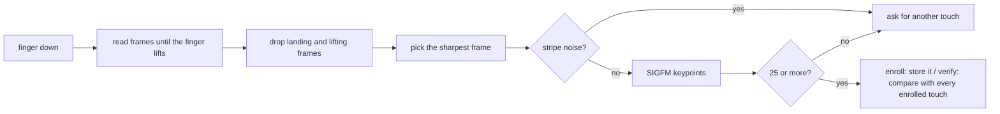

# How it works

This is the long version of why the stock driver fails on the `04f3:0c28` and what the patch changes. Everything here applies only to that USB ID, the patch sets a flag on `0c28` in the driver's ID table and every new code path checks that flag first.

## The sensor

The FeinTech FPS00200 has an ELAN chip that reports itself as a 96x96 pixel sensor. At ~500 dpi that's about 5x5 mm of your fingertip. You press and hold it, there's no swiping involved.

## Why the stock driver can't match

libfprint's `elan` driver was written for the ELAN sensors in laptop touchpads, which are 144x64 strips that you swipe across. It reads a stream of frames while your finger moves, crops each frame to 50 rows, guesses how far the finger moved between frames, and stitches them into one tall image. The driver even has a comment from its author saying they never had a 96x96 sensor and didn't know if those would work.

On a press sensor the finger doesn't move, so the stitching guesses at random. In my debug logs the motion estimate couldn't decide between up and down (the error scores for both directions were nearly identical) and once it even produced an image with a negative height. Every match scored 0 out of the 24 the matcher needs.

Fixing the capture wasn't enough though. libfprint matches fingerprints with NBIS, which finds minutiae (the points where ridges end or split) and compares their positions. A 5x5 mm patch just doesn't have many of them:

| Image | Minutiae per scan | Best score between two scans of the same finger |
|---|---|---|
| 96x96 native | 2.2 | 0 |
| 2x upscaled | 5.2 | 4 |

NBIS needs 24, so no amount of capture tuning would have fixed it.

## What the patch does

### Capture

The driver keeps reading frames until you lift your finger, same as the swipe code does. That part matters more than it looks, because the sensor calibrates against an empty pad before every touch, and if the driver stops reading while your finger is still down, the next calibration measures your finger as the background and fails.

From the frames it read, the driver drops the first two (finger still settling) and the last two (finger lifting), then picks the sharpest one left, measured as the sum of differences between neighbouring pixels. I tried averaging the frames first and it blurred the ridges whenever the finger shifted a little, so a single sharp frame works better.

Some touches produce vertical stripe noise instead of ridges. The driver compares how much of the image's variation comes from the column averages alone. Real ridges score at most 0.65 in my captures and the noise scored 0.81, so anything above 0.75 gets rejected and you're asked to touch again. This check exists because a noise frame enrolled as your finger could match another noise frame later.

### Matching

Instead of NBIS, the patch uses SIGFM. It finds keypoints in the image with FAST-9, describes the texture around each one with BRIEF-256, and scores a pair of images by how many keypoints line up under a single rotation and shift (RANSAC). Ridge texture is everywhere on a fingerprint, so a 96x96 image gives about 128 keypoints even when NBIS finds 2 minutiae.

A touch with fewer than 25 keypoints is rejected. Verify compares your touch against every enrolled touch and takes the best score, 7 or more is a match. Both numbers come from the [GF511 benchmarks](https://github.com/buxel/libfprint-27c6-5110/blob/main/BENCHMARKS.md), where the highest score any wrong finger got was 6. In my testing on this sensor wrong fingers topped out at 3 and the right finger scored between 7 and 20 when it matched.

Since the sensor only sees part of your finger on each touch, enroll asks for 15 touches instead of the stock 5. Each one adds a different patch of your finger to the print.

### Storage

SIGFM data is stored as a libfprint `RAW` print: a list with one SIGFM blob per enrolled touch. fprintd saves and loads these like any other print, so nothing changes on the fprintd side. Prints enrolled with the stock driver are NBIS prints and don't carry SIGFM data, so you have to enroll again after installing.

## Changes to libfprint itself

Most of the patch is in the `elan` driver, but libfprint's shared image pipeline always used NBIS, so it needed a small hook. A driver can call `fpi_image_device_set_matcher()` from its open callback to replace two steps: building a print from an image, and comparing a print with a stored one. Only the `elan` driver calls it, and only for `0c28`. Every other image driver goes through the same NBIS code as before, and libfprint's test suite passes with the patch applied.

| File | Change |
|---|---|
| `drivers/elan.c`, `drivers/elan.h` | press mode for `0c28`, frame selection, stripe check, SIGFM extract and match |
| `drivers/sigfm.c`, `drivers/sigfm.h` | SIGFM, copied unchanged from [buxel/libfprint](https://github.com/buxel/libfprint) |
| `fpi-image-device.c`, `fpi-image-device.h`, `fp-image-device-private.h` | the matcher hook |
| `fp-image-device.c` | enroll prints become `RAW` when a device uses its own matcher |
| `fpi-print.c` | `RAW` enroll prints collect one blob per touch |
| `meson.build` | builds `sigfm.c` with the `elan` driver |
